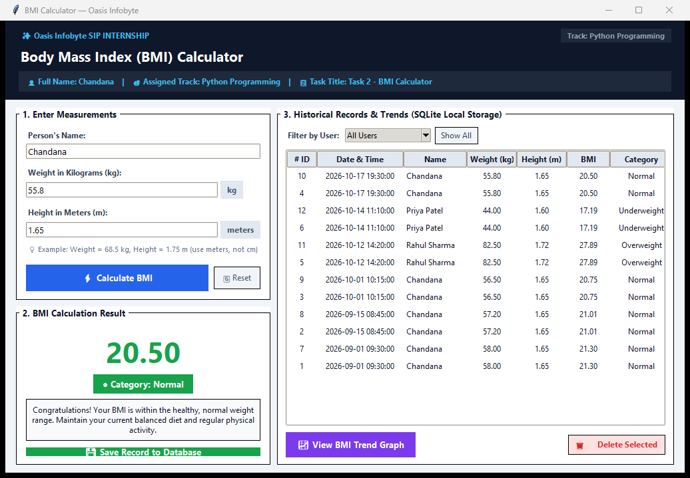
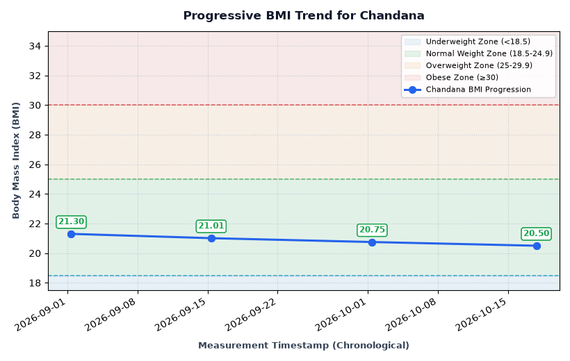

# Oasis Infobyte SIP — Python Programming Internship

## Task 2: Body Mass Index (BMI) Calculator & Analytics

| Field | Details |
| :--- | :--- |
| **Intern Name** | Chandana |
| **Internship Track** | Python Programming |
| **Task Number** | Task 2 |
| **Task Title** | BMI Calculator |
| **Organization** | Oasis Infobyte (OIBSIP) |
| **Operating System** | Windows 11 |
| **Programming Language** | Python 3 (Python 3.14 / 3.10+) |
| **Repository Name** | `OIBSIP` |
| **Task Folder** | `Python-Task2-BMICalculator` |

---

## 1. Project Overview & Objective

The objective of this project is to create a robust, production-grade **Body Mass Index (BMI) Calculator** with native desktop Graphical User Interface (GUI), persistent SQLite database storage, and progressive historical trend analytics.

The application strictly implements all mandatory requirements from the **Oasis Infobyte Python Programming Task 2 Checklist**, alongside advanced capabilities including multi-user profile tracking, color-coded medical category feedback, SQL parameterized safety, and visual trend graphing via Matplotlib.

---

## 2. Features Implemented

### Required Core (Beginner) Features
- [x] **Weight Acceptance**: Accepts user weight in kilograms ($kg$) with strict numeric parsing.
- [x] **Height Acceptance**: Accepts user height in meters ($m$) with clear unit indicators.
- [x] **Standard BMI Calculation**:
  $$\text{BMI} = \frac{\text{weight (kg)}}{(\text{height (m)})^2}$$
- [x] **Official Category Classification** (matching Oasis Infobyte specification):
  - **Underweight**: BMI below $18.5$ ($< 18.5$)
  - **Normal**: BMI from $18.5$ to $24.9$ ($18.5 \le \text{BMI} < 25.0$)
  - **Overweight**: BMI from $25.0$ to $29.9$ ($25.0 \le \text{BMI} < 30.0$)
  - **Obese**: BMI $30.0$ or above ($\ge 30.0$)
- [x] **Precise Rounding**: Formats and displays BMI rounded strictly to **two decimal places** (e.g., `22.86`).
- [x] **Actionable Health Recommendations**: Context-aware clinical guidance based on classified category.
- [x] **Comprehensive Input Validation**:
  - Rejects empty, missing, or whitespace-only inputs with informative dialogs.
  - Rejects non-numeric strings and special characters gracefully.
  - Rejects zero ($0$) and negative ($< 0$) weight or height values.
  - Verifies human physiological limits ($1 \text{ kg} - 500 \text{ kg}$, $0.30 \text{ m} - 2.80 \text{ m}$).
- [x] **Crash-Proof Fault Tolerance**: Structured `try-except` blocks prevent crashes on invalid operations.

### Advanced Features Implemented
- [x] **Native Tkinter Desktop GUI**: Modern, responsive window titled `"BMI Calculator — Oasis Infobyte"`.
- [x] **Prominent Identity Banner**: Displays student name (**Chandana**), assigned track (**Python Programming**), and task title for video demo compliance.
- [x] **Color-Coded Visual Category Feedback**:
  - 🔵 **Underweight**: `#0284c7` (Sky Blue)
  - 🟢 **Normal**: `#16a34a` (Forest Green)
  - 🟠 **Overweight**: `#d97706` (Amber / Orange)
  - 🔴 **Obese**: `#dc2626` (Crimson Red)
- [x] **Multi-User Profile Support**: Allows entering any person's name and storing separate records.
- [x] **Persistent SQLite Local Database (`bmi_history.db`)**:
  - Embedded relational database initialized automatically on startup.
  - Parameterized SQL queries (`?`) prevent SQL injection attacks.
  - Indexed columns for rapid historical retrieval.
- [x] **Interactive History Viewer**:
  - Built-in `ttk.Treeview` table showing ID, Date & Time, Name, Weight, Height, BMI, and Category.
  - Filter records by specific user or view all users simultaneously.
  - Delete unwanted historical entries with confirmation dialogs.
- [x] **Progressive BMI Trend Graph (Matplotlib)**:
  - Interactive window plotting chronological BMI changes for any selected user.
  - Shaded horizontal visual zones for Underweight, Normal, Overweight, and Obese ranges.
  - Threshold dashed guidelines at $18.5$, $25.0$, and $30.0$.
  - Exact BMI callout badges on every data point.
  - Navigation toolbar with zoom, pan, and PNG export capabilities.
- [x] **Dual Interface Support**:
  - **GUI Mode** (Default): Launch full desktop GUI.
  - **CLI Mode** (`py main.py --cli`): Clean terminal menu for headless or rapid operations.

---

## 3. Technologies Used

| Technology | Purpose |
| :--- | :--- |
| **Python 3** | Core programming language |
| **Tkinter & ttk** | Native desktop graphical user interface (Standard Library) |
| **SQLite3** | Embedded local relational database storage (Standard Library) |
| **Matplotlib** | Chronological BMI trend plotting and visualization (External Dependency) |
| **Datetime** | Timestamp tracking for historical measurements (Standard Library) |
| **Typing** | Strict type hinting for readability and maintainability (Standard Library) |

---

## 4. Project Folder Structure

```
OIBSIP/
└── Python-Task2-BMICalculator/
    ├── main.py                  # Main application source (GUI, CLI, DB, Analytics)
    ├── test_suite.py            # Automated 11-step verification suite
    ├── requirements.txt         # External package dependencies (matplotlib)
    ├── README.md                # Comprehensive project documentation
    ├── bmi_history.db           # SQLite database storing historical records
    └── screenshots/
        ├── demo-output.png      # Real capture of running Tkinter application
        └── trend-graph.png      # Real capture of Matplotlib trend visualization
```

---

## 5. System Requirements & Windows 11 Setup

### Prerequisites
- **Operating System**: Windows 11 (or Windows 10)
- **Python**: Python 3.10 or higher (Tested and verified on Python 3.14.2)
- **Python Launcher**: `py` launcher included with standard Windows Python installer

### Step-by-Step Installation Instructions

1. **Open PowerShell or Windows Terminal**:
   Press `Win + X` and select **Terminal** or **PowerShell**.

2. **Navigate to the Project Directory**:
   ```powershell
   cd C:\Users\Chandana\OneDrive\Desktop\OIBSIP\Python-Task2-BMICalculator
   ```

3. **Install Required External Dependency (`matplotlib`)**:
   ```powershell
   py -m pip install -r requirements.txt
   ```
   *(Note: `tkinter`, `sqlite3`, and `datetime` are built directly into Python and require no installation).*

4. **Verify Environment Setup**:
   ```powershell
   py -c "import tkinter, sqlite3, matplotlib; print('Environment is ready!')"
   ```

---

## 6. How to Run the Application

### 1. Launch the Desktop GUI (Default Mode)
```powershell
py main.py
```
*(or run explicitly with `py main.py --gui`)*

### 2. Launch the Interactive Command-Line Interface (CLI Mode)
```powershell
py main.py --cli
```

### 3. Run the Automated Verification Test Suite
```powershell
py test_suite.py
```

---

## 7. User Operation Guide

### Calculating BMI
1. Launch the application (`py main.py`).
2. Enter the person's name in the **Person's Name** input field (pre-filled with `Chandana`).
3. Enter the weight in kilograms in the **Weight (kg)** field (e.g., `55.8`).
4. Enter the height in meters in the **Height (m)** field (e.g., `1.65`).
5. Click the primary blue **⚡ Calculate BMI** button.
6. The application immediately displays:
   - BMI score rounded to two decimal places (e.g., `20.50`).
   - Color-coded Category Badge (e.g., green `● Category: Normal`).
   - Tailored clinical health recommendation.

### Saving Historical Records
1. Once BMI is calculated, the green **💾 Save Record to Database** button becomes active.
2. Click **Save Record to Database**.
3. A confirmation dialog confirms the record is safely written to `bmi_history.db`.
4. The historical table on the right immediately refreshes with the new entry.

### Viewing History and Filtering
- The **Historical Records** table lists all stored measurements with exact timestamps.
- Use the **Filter by User** dropdown to view records for a specific individual (e.g., `Chandana`, `Rahul Sharma`).
- Click **Show All** to restore the full historical log.
- To remove an entry, highlight the row in the table and click **🗑️ Delete Selected**.

### Viewing the BMI Trend Graph
1. Select a user in the **Filter by User** dropdown or ensure their name is in the input field.
2. Click the purple **📈 View BMI Trend Graph** button.
3. A dedicated Matplotlib visualization window opens displaying:
   - Chronological progression line with circular markers.
   - Exact BMI values annotated above each measurement.
   - Shaded clinical reference zones:
     - Blue: Underweight ($< 18.5$)
     - Green: Normal ($18.5 - 24.9$)
     - Amber: Overweight ($25.0 - 29.9$)
     - Red: Obese ($\ge 30.0$)
   - Interactive zoom, pan, and save buttons in the navigation toolbar.

---

## 8. Database Architecture & Safety

The application stores records locally in an embedded **SQLite 3** relational database named `bmi_history.db`.

### Database Schema
```sql
CREATE TABLE IF NOT EXISTS bmi_records (
    id INTEGER PRIMARY KEY AUTOINCREMENT,
    name TEXT NOT NULL,
    weight REAL NOT NULL,
    height REAL NOT NULL,
    bmi REAL NOT NULL,
    category TEXT NOT NULL,
    timestamp TEXT NOT NULL
);

CREATE INDEX IF NOT EXISTS idx_bmi_name ON bmi_records (name);
```

### Security & Safety Measures
- **Parameterized SQL Queries**: All database queries use `?` placeholders (`cursor.execute(sql, (val1, val2, ...))`), completely eliminating SQL injection risks.
- **Atomic Transactions**: Context managers (`with sqlite3.connect(...) as conn:`) ensure database transactions commit safely or rollback cleanly upon failure.
- **Graceful Error Handling**: Database connection or disk write errors return descriptive boolean status tuples rather than unhandled tracebacks.

---

## 9. Boundary Handling & Clinical Logic Documentation

The Oasis Infobyte internship specification defines categories using rounded range notations:
- **Underweight**: BMI below $18.5$
- **Normal**: BMI from $18.5$ to $24.9$
- **Overweight**: BMI from $25$ to $29.9$
- **Obese**: BMI $30$ or above

### Boundary Interpretation
To maintain mathematical consistency between continuous clinical intervals and rounded decimal displays:
- A BMI rounded to 2 decimal places that is strictly less than $18.50$ (such as $18.49$) is classified as **Underweight**.
- A BMI from $18.50$ to $24.99$ (including the boundary point $24.90$) is classified as **Normal**.
- A BMI from $25.00$ to $29.99$ (including boundary points $25.00$ and $29.90$) is classified as **Overweight**.
- A BMI of $30.00$ or higher is classified as **Obese**.

---

## 10. Automated Testing & Verification Performed

The project includes an automated test suite (`test_suite.py`) validating 11 rigorous test criteria. Every test was executed on Windows 11 using Python 3.14.2:

```
============================================================================
STARTING TEST SUITE: OASIS INFOBYTE TASK 2 - BMI CALCULATOR
============================================================================
[PASS] Test 1: BMI Calculation Formula Precision Verified (70kg, 1.75m -> 22.857143)
[PASS] Test 2: BMI Display Formatting Verified (22.8571 -> '22.86', 25.0 -> '25.00')
[PASS] Test 3: Input Validation - Empty and Whitespace Fields Successfully Rejected
[PASS] Test 4: Input Validation - Non-Numeric Values Gracefully Rejected with Helpful Error
[PASS] Test 5: Input Validation - Zero and Negative Weight Values Successfully Rejected
[PASS] Test 6: Input Validation - Zero and Negative Height Values Successfully Rejected
[PASS] Test 7: All Category Boundaries Verified (18.49, 18.50, 24.90, 25.00, 29.90, 30.00)
[PASS] Test 8: SQLite Database Operations (Schema, Parameterized Insert, Read, Index) Verified
[PASS] Test 9: Chronological Ascending Ordering and User Filtering Verified for Analytics
[PASS] Test 10: SQLite Error Handling Tested - System Handles Failures Gracefully Without Crashing
[PASS] Test 11: Matplotlib Trend Plotting Engine Verified (Figure, Bands, Render, Savefig OK)
============================================================================
TEST RESULTS: 11/11 TESTS PASSED (100.0% SUCCESS)
============================================================================
```

---

## 11. Application Visual Demonstration

### Desktop Graphical Interface


### Matplotlib Progressive Trend Analysis


---

## 12. Video Demonstration Guidelines (For Oasis Infobyte Submission)

When recording your screen demonstration video:

1. **First 2 Seconds**: Keep the window visible showing the prominent identity header card:
   - **Full Name**: Chandana
   - **Assigned Track**: Python Programming
   - **Task Title**: Task 2 – BMI Calculator
2. **Main Demonstration**:
   - Demonstrate entering weight and height.
   - Click **⚡ Calculate BMI** and highlight the result and green **Normal** category badge.
   - Click **💾 Save Record to Database**.
   - Show the record appearing in the historical records table.
   - Click **📈 View BMI Trend Graph** to demonstrate the Matplotlib historical trend analysis.
   - Show input validation by entering invalid text (e.g. negative number or letter) and displaying the error dialog.

---

## 13. Suggested LinkedIn Post

```
🚀 Thrilled to share my Task 2 project for the Oasis Infobyte SIP Python Programming Internship!

📌 Task 2: Body Mass Index (BMI) Calculator & Analytics
👤 Name: Chandana
💻 Track: Python Programming
🏢 Organization: Oasis Infobyte

Key Features Implemented:
✨ Native Desktop GUI built with Python's Tkinter & ttk
✨ Accurate BMI calculation with 2-decimal formatting & clinical classification
✨ Color-coded health category feedback (Underweight, Normal, Overweight, Obese)
✨ Persistent historical record tracking powered by SQLite3
✨ Visual BMI trend progression graph over time utilizing Matplotlib
✨ Strict input validation rejecting empty, non-numeric, zero, and negative values

A huge thank you to Oasis Infobyte for this fantastic learning opportunity! 🌟

#oasisinfobyte #python #internship #programming #datascience #softwaredevelopment #gui #tkinter #sqlite #matplotlib #oibsip
```
