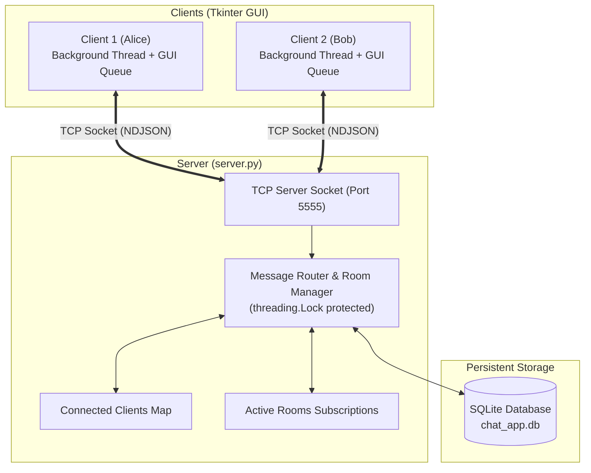
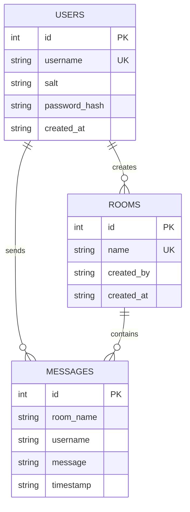

# ⚡ Oasis Infobyte Python Internship — Task 5: Real-Time Chat Application


-indigo.svg)

-orange.svg)


A professional, multi-room, real-time messaging desktop application built in Python for the **Oasis Infobyte Python Programming Internship (Advanced Tier)**. It features cryptographic user authentication, live multi-client communication using low-level TCP sockets and threading, isolated chat rooms, persistent SQLite message history, Unicode emoji support, desktop notifications, and a modern Tkinter user interface.

---

## 📋 Table of Contents
1. [Project Overview](#-project-overview)
2. [Why This Architecture?](#-why-this-architecture)
3. [Key Features](#-key-features)
4. [Architecture & Protocol Design](#-architecture--protocol-design)
5. [Database Schema](#-database-schema)
6. [Project Structure](#-project-structure)
7. [Installation & Setup](#-installation--setup)
8. [How to Run the Application](#-how-to-run-the-application)
   - [Method 1: Interactive Unified Launcher (Recommended)](#method-1-interactive-unified-launcher-recommended)
   - [Method 2: Running Server & Multiple Clients Manually in VS Code](#method-2-running-server--multiple-clients-manually-in-vs-code)
9. [Automated Test Suite & Verification](#-automated-test-suite--verification)
10. [Beginner's Technical Deep Dive](#-beginners-technical-deep-dive)
    - [What are Sockets?](#1-what-are-sockets)
    - [Why is Threading Essential in Tkinter?](#2-why-is-threading-essential-in-tkinter)
    - [How Password Hashing Works (PBKDF2)](#3-how-password-hashing-works-pbkdf2)
    - [How Message History is Stored & Loaded](#4-how-message-history-is-stored--loaded)
11. [Troubleshooting & Common Questions](#-troubleshooting--common-questions)
12. [Security & Limitations](#-security--limitations)
13. [Future Enhancements](#-future-enhancements)

---

## 🎯 Project Overview

In networked software development, real-time communication is one of the most critical foundational concepts. This project implements a full client-server chat application designed to meet and exceed all requirements of the **Oasis Infobyte Internship Task 5 (Advanced Tier)**.

Rather than relying on high-level third-party cloud SDKs or heavyweight web frameworks, this project is engineered using **Python's core networking, threading, and GUI standard libraries**. This ensures zero external installation issues, lightning-fast transmission, and deep mastery of networking fundamentals (TCP streaming, frame delimitation, concurrency locks, and thread-safe event queues).

---

## 💡 Why This Architecture?

| Component | Technology | Rationale |
| :--- | :--- | :--- |
| **Networking** | Python `socket` (TCP/IP) | Provides full control over socket lifecycles, connection buffers, and bidirectional duplex streaming without relying on third-party web frameworks. |
| **Concurrency** | Python `threading` + `queue.Queue` | Handles dozens of concurrent client connections simultaneously on the server. On the client, prevents the Tkinter GUI from freezing while waiting for network packets. |
| **GUI Framework** | Python `tkinter` (Custom Dark/Indigo Theme) | Desktop-native, cross-platform interface that runs out of the box on Windows, macOS, and Linux without installing complex C++ binaries. |
| **Database** | Python `sqlite3` | Lightweight, zero-configuration relational database with ACID compliance, storing user credentials, rooms, and chat logs with 100% parameterized queries. |
| **Serialization** | Newline-Delimited JSON (NDJSON) | Clean, human-readable, schema-flexible protocol packets that resolve TCP stream fragmentation cleanly. |
| **Security** | `hashlib.pbkdf2_hmac` with Salt | Cryptographically secure password protection with 100,000 hash iterations, protecting user credentials against dictionary attacks and rainbow tables. |

---

## ✨ Key Features

### 1. 🔐 User Registration & Authentication
- New users can register with a unique username and secure password.
- Strict input validation: usernames are validated for length (3–20 characters) and allowed characters (alphanumeric + underscores). Passwords must be at least 6 characters.
- Passwords are **never stored in plain text**. Each user receives a unique 16-byte cryptographically secure salt, and the hash is generated using `PBKDF2-HMAC-SHA256`.
- Login verification uses constant-time string comparison (`hmac.compare_digest`) to prevent timing attacks.
- Duplicate account logins on multiple devices are detected and rejected.

### 2. 🎨 Modern Dark-Mode Tkinter GUI
- Styled with a modern **Deep Slate & Indigo Accent** palette (`#13141f`, `#1e1f2e`, `#6366f1`).
- Clean view switcher between the **Authentication Screen** (with tabbed Login/Register and a password visibility toggle 👁️) and the **Main Chat Dashboard**.
- Styled chat messages with distinct visual cards:
  - **Sent messages**: Indented right, highlighted in indigo (`#4f46e5`).
  - **Received messages**: Indented left, soft dark slate background (`#282a3c`).
  - **System announcements**: Centered notices for user joins, departures, and room creations.

### 3. 🌐 Multiple Isolated Chat Rooms
- Users can create custom named chat rooms on the fly (e.g., `#Python Hub`, `#Oasis Interns`).
- Room list automatically synchronizes in real time across all connected clients whenever a new room is created.
- **Strict room isolation**: messages sent in Room A are only received by users actively inside Room A.
- Displays an active **Online Users in Room** sidebar section showing everyone in the current room.

### 4. ⚡ Real-Time Bidirectional Messaging
- Bidirectional TCP socket streams guarantee immediate message delivery.
- Uses a decoupled **Producer-Consumer architecture** (`threading.Thread` + `queue.Queue` + `root.after()`) so the Tkinter UI stays fluid and responsive during high-frequency chats.

### 5. 📜 Persistent Message History
- All sent messages are automatically persisted to the SQLite database with sender, room name, message body, and timestamp.
- When any user enters a chat room, the server loads the previous 50 messages and displays them with a clean historical divider banner (`── Previous Message History ──`).

### 6. 😀 Unicode Emoji Support & Quick Bar
- Full native support for UTF-8 Unicode emojis (e.g., 😀, 😂, 😍, 👍, 🎉, 🔥, ❤️, 🚀, 👏, 🙌, 😎, 🤔, 💡, 💻, 🐍, ✨).
- Features a quick-click emoji bar right above the input box to instantly insert emojis into your message.

### 7. ⏰ Formatted Timestamps
- Every message displays a clean bracketed timestamp: `[14:35]`.
- Timestamps are computed by the server upon receipt to prevent client clock drift.

### 8. 🔔 Smart Desktop Notifications & Focus Tracking
- Plays an audio chime (`root.bell()`) when a new message arrives from another user.
- In-app notification toast appears in the top navigation bar with a snippet of incoming messages.
- Tracks window focus: if the chat window is minimized or in the background, the title changes to alert the user: `(3 New Messages) Oasis Chat — #General`.

### 9. 🛡️ Graceful Disconnections & Fault Tolerance
- When a user closes the window or clicks "Logout", a departure notification (`user_left`) is broadcast to the room.
- If the server shuts down unexpectedly, clients detect the socket closure and display a friendly notice without crashing the Tkinter event loop.

---

## 🏗️ Architecture & Protocol Design

### System Overview Diagram



### JSON Protocol Specifications
Packets are sent over TCP as newline-delimited JSON strings (`{"action": ...}\n`):

| Action | Direction | Payload Example | Description |
| :--- | :--- | :--- | :--- |
| `register` | Client → Server | `{"action": "register", "username": "alice", "password": "..."}` | Register a new user |
| `login` | Client → Server | `{"action": "login", "username": "alice", "password": "..."}` | Authenticate user |
| `create_room` | Client → Server | `{"action": "create_room", "room_name": "AI-Hub"}` | Create a new chat room |
| `join_room` | Client → Server | `{"action": "join_room", "room_name": "AI-Hub"}` | Switch to a chat room |
| `send_message` | Client → Server | `{"action": "send_message", "room_name": "AI-Hub", "message": "Hi! 🚀"}` | Send a live message |
| `new_message` | Server → Room | `{"action": "new_message", "username": "alice", "message": "Hi! 🚀", "timestamp": "[14:35]"}` | Broadcast chat message |
| `user_joined` | Server → Room | `{"action": "user_joined", "room_name": "...", "username": "bob", "timestamp": "..."}` | Announce new arrival |
| `user_left` | Server → Room | `{"action": "user_left", "room_name": "...", "username": "bob", "timestamp": "..."}` | Announce departure |
| `disconnect` | Client → Server | `{"action": "disconnect"}` | Graceful exit notification |

---

## 🗄️ Database Schema

The SQLite3 database (`chat_app.db`) contains three relational tables:



---

## 📁 Project Structure

```
OIBSIP4/
│
├── main.py             # Unified launcher CLI (start server, client, demo, or tests)
├── server.py           # Multi-threaded TCP Chat Server
├── client.py           # Modern Tkinter GUI Chat Client
├── database.py         # SQLite3 database manager & PBKDF2 password security
├── test_chat.py        # Automated test suite (tests all 12 mandatory requirements)
├── requirements.txt    # Project dependencies and environment documentation
├── .gitignore          # Git exclusion rules for databases, cache, and OS files
└── README.md           # Comprehensive project documentation
```

---

## 🚀 Installation & Setup

### Prerequisites
- Python **3.8 or higher** installed on your system.
- Standard libraries: `tkinter`, `sqlite3`, `socket`, `threading`, `json`, `hashlib`. (All included in standard Python installations).

### 1. Clone or Open the Project
Open VS Code and navigate to the project directory:
```bash
cd c:\Users\Chandana\OneDrive\Desktop\OIBSIP4
```

### 2. Verify Python Installation
In your terminal, check that Python is accessible:
```bash
py --version
# or
python --version
```

*(Note: On Windows, if `python` opens the Microsoft Store, use `py` or run Python via its full path).*

---

## 🖥️ How to Run the Application

### Method 1: Interactive Unified Launcher (Recommended)
We have included a beginner-friendly interactive launcher:
```bash
py main.py
```
This presents an interactive menu:
```
======================================================================
  ⚡ OASIS INFOBYTE PYTHON INTERNSHIP — TASK 5: CHAT APPLICATION ⚡
======================================================================
Please choose an option to run:
  [1] Start Chat Server
  [2] Launch Chat Client (GUI)
  [3] Launch Server + 2 Clients (Live Demo)
  [4] Run Automated Verification Tests
  [5] Exit
```
Selecting **`[3]`** will instantly start the server and open **two separate client windows side-by-side** on your screen!

You can also run specific modes directly using CLI flags:
```bash
py main.py --demo      # Starts server + opens 2 client windows
py main.py --server    # Starts only the server
py main.py --client    # Launches one client window
py main.py --test      # Runs the full automated test suite
```

---

### Method 2: Running Server & Multiple Clients Manually in VS Code

To test real-time communication between multiple clients as required by Oasis Infobyte:

#### Step 1: Open Terminal 1 (Start Server)
In VS Code, open a new terminal (**Terminal → New Terminal**) and execute:
```bash
py server.py
```
You will see:
```
[2026-11-13 14:15:20] [INFO] Chat Server running on 127.0.0.1:5555
[2026-11-13 14:15:20] [INFO] Waiting for incoming client connections...
```

#### Step 2: Open Terminal 2 (Start First Client — Alice)
Click the **`+`** icon in the VS Code terminal pane to open a second terminal tab, then run:
```bash
py client.py
```
1. The login window will open. Click the **Register** tab.
2. Enter username: `alice`, password: `password123`. Click **Create Account**.
3. Switch back to **Log In**, enter credentials, and click **Log In to Chat**.
4. Alice enters the `# General` chat room!

#### Step 3: Open Terminal 3 (Start Second Client — Bob)
Open a third terminal tab in VS Code and run:
```bash
py client.py
```
1. Click **Register**, enter username: `bob`, password: `password123`, and submit.
2. Log in as `bob`.
3. Notice that Alice immediately sees: `[14:16] → bob joined #General`!
4. Send messages between Alice and Bob: messages, emojis (🚀, 🐍), and timestamps appear in real time on both windows!

---

## 🧪 Automated Test Suite & Verification

The project includes an automated test script (`test_chat.py`) that boots up an isolated test server on port `5599`, spins up mock client sockets, and rigorously tests all **12 requirements**:

```bash
py test_chat.py
```

### Verified Test Results:
```text
======================================================================
   RUNNING AUTOMATED TEST SUITE — TASK 5 CHAT APPLICATION
======================================================================
[PASS] Test Server started on port 5599
[PASS] 1. New user registration & duplicate check verified.
[PASS] 2. User login verified successfully.
[PASS] 3. Incorrect password handling verified (rejected safely).
[PASS] 4. Multiple simultaneous client connections verified.
[PASS] 5. Creating chat rooms and live room list broadcast verified.
[PASS] 6. Room joining and room isolation verified.
[PASS] 7. Bidirectional real-time messaging verified.
[PASS] 8. Unicode Emoji transmission verified.
[PASS] 9. Timestamps formatting verified: [14:18]
[PASS] 10. Message history loaded from SQLite verified (3 messages restored).
[PASS] 11. User graceful disconnection and departure broadcast verified.
[PASS] 12. Server shutdown handling verified.
======================================================================
   TEST SUMMARY: 12/12 TESTS PASSED SUCCESSFULLY! (100%)
======================================================================
```

---

## 🎓 Beginner's Technical Deep Dive

### 1. What are Sockets?
A socket is an endpoint for sending and receiving data across a computer network. When you browse the web or send a chat message, your computer opens a socket to the server.
- We use **TCP (Transmission Control Protocol)** (`socket.SOCK_STREAM`), which is connection-oriented, reliable, and guarantees in-order delivery of bytes.
- Because TCP sends raw byte streams without knowing where one message ends and the next begins, we frame our messages using a newline delimiter (`\n`). Every packet is serialized as a JSON string followed by `\n`.

### 2. Why is Threading Essential in Tkinter?
Tkinter runs on a single main event loop (`root.mainloop()`). This loop listens for mouse clicks, keyboard presses, and redraws the screen.
- If you call `sock.recv()` inside Tkinter's main thread, the entire program will freeze until data arrives from the network!
- To prevent this, the client runs a **background worker thread** (`threading.Thread`) that waits for incoming data. When a message arrives, it places it in a thread-safe `queue.Queue()`.
- The main Tkinter thread checks this queue every 50 milliseconds using `root.after()`. This guarantees the GUI stays silky-smooth!

### 3. How Password Hashing Works (PBKDF2)
Never store passwords in plain text! If a database is ever leaked, plain-text passwords expose users across other sites.
- We use **PBKDF2 (Password-Based Key Derivation Function 2)** with HMAC-SHA256 and **100,000 rounds**.
- A unique **salt** (16 random bytes generated by `os.urandom(16)`) is assigned to every user.
- Even if two users choose the exact same password ("password123"), their stored password hashes are completely different because their salts are unique.

### 4. How Message History is Stored & Loaded
- When a user sends a message, `database.save_message(...)` inserts the room name, sender username, message text, and timestamp into the SQLite table.
- When any user joins a room, `database.get_room_history(room_name, limit=50)` retrieves the last 50 messages ordered by ID ascending.
- The client receives this history packet, renders it in the chat area, and displays a clean banner so users know they are viewing past conversation logs.

---

## 🛠️ Troubleshooting & Common Questions

### Q1: `py` or `python` opens the Microsoft Store on Windows.
- **Solution**: Go to Windows Settings → Apps → Advanced app settings → **App execution aliases**. Turn **OFF** the toggles for "python.exe" and "python3.exe". Then run `py main.py` or use the full path to your Python installation.

### Q2: Error: "Could not connect to 127.0.0.1:5555. Make sure server.py is running!"
- **Solution**: The client cannot chat without a running server. Start `server.py` in a separate terminal before logging in with `client.py`.

### Q3: How do I connect from another computer on the same Wi-Fi?
- In `server.py`, change `DEFAULT_HOST = "127.0.0.1"` to `"0.0.0.0"`.
- On the client computer, enter the server machine's local IP address (e.g., `192.168.1.5`) in the "Server Host" box on the login screen.

---

## 🔒 Security & Limitations

1. **Local Network Scope**: This application is designed for local and LAN environments.
2. **Transport Security Disclaimer**: Messages and authentication packets are sent over standard TCP sockets using UTF-8 JSON. They are not end-to-end encrypted (E2EE) with TLS/SSL. In production internet environments, TLS encryption (`ssl.wrap_socket`) should be added to prevent network eavesdropping.
3. **Database Security**: SQL injection is 100% prevented using SQLite parameterized queries (`?` placeholders). Passwords are never stored in plain text and are protected with salted PBKDF2-SHA256 hashes.

---

## 🚀 Future Enhancements
- [ ] Add TLS/SSL encryption for end-to-end transport security.
- [ ] Direct one-on-one private messaging (DMs) between individual users.
- [ ] File transfer and image sharing support over socket chunks.
- [ ] Voice and audio note messaging.
- [ ] User profile avatars and status messages ("Busy", "Away", "Coding 🐍").

---

## 👨‍💻 Author & Acknowledgements
- **Author**: Chandana
- **Internship**: Oasis Infobyte Python Programming Internship
- **Task**: Task 5 – Chat Application (Advanced Tier)
- **Submission Date**: November 2026

*Developed with passion for clean code, networking fundamentals, and intuitive user experiences.*
